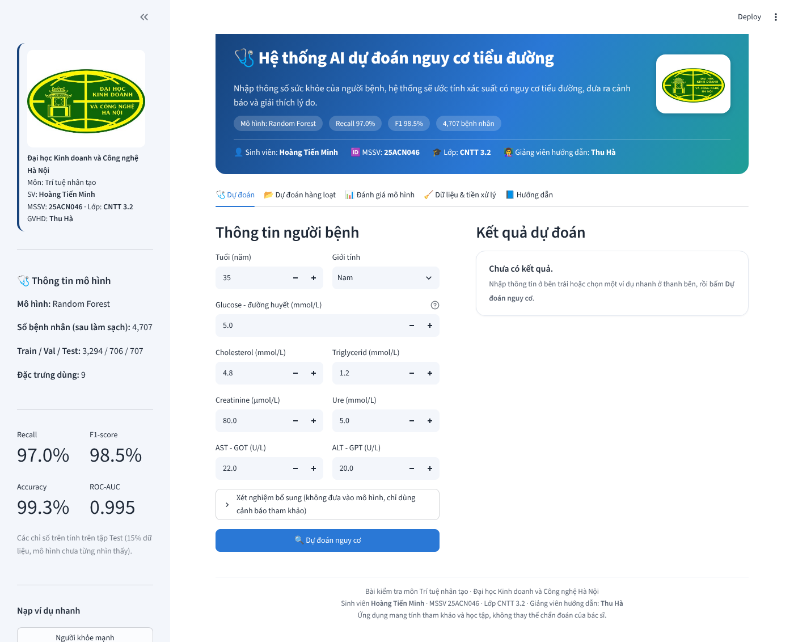
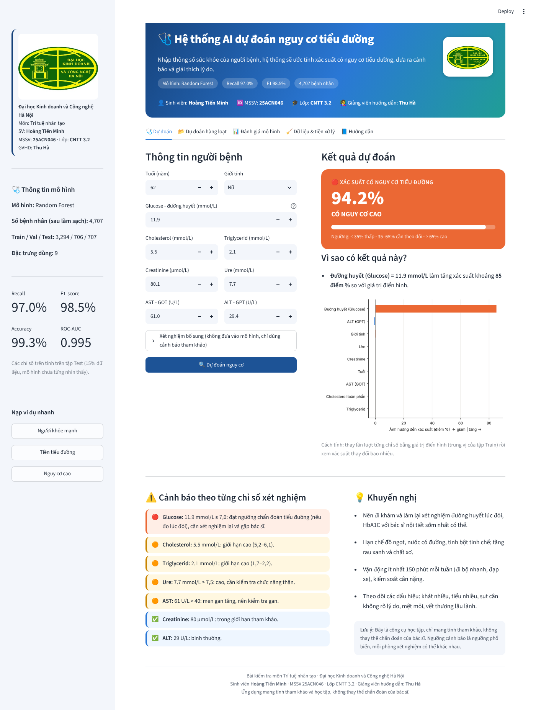
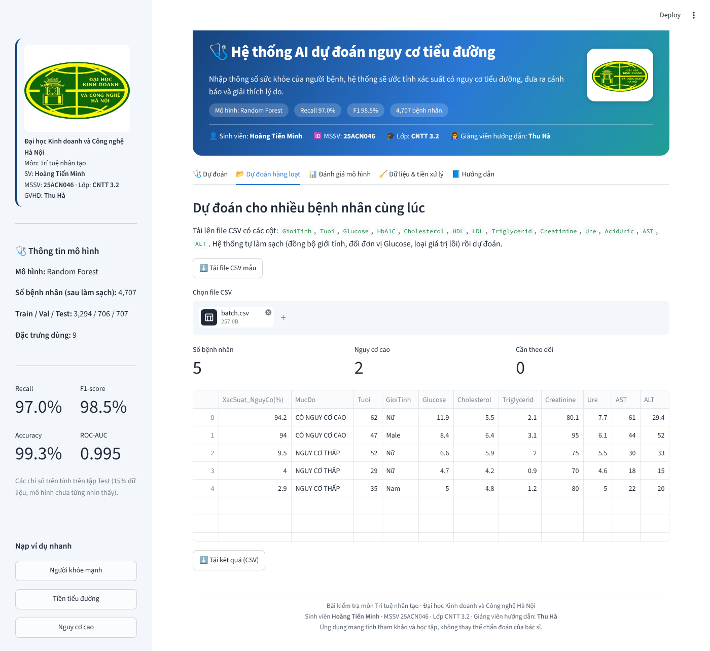
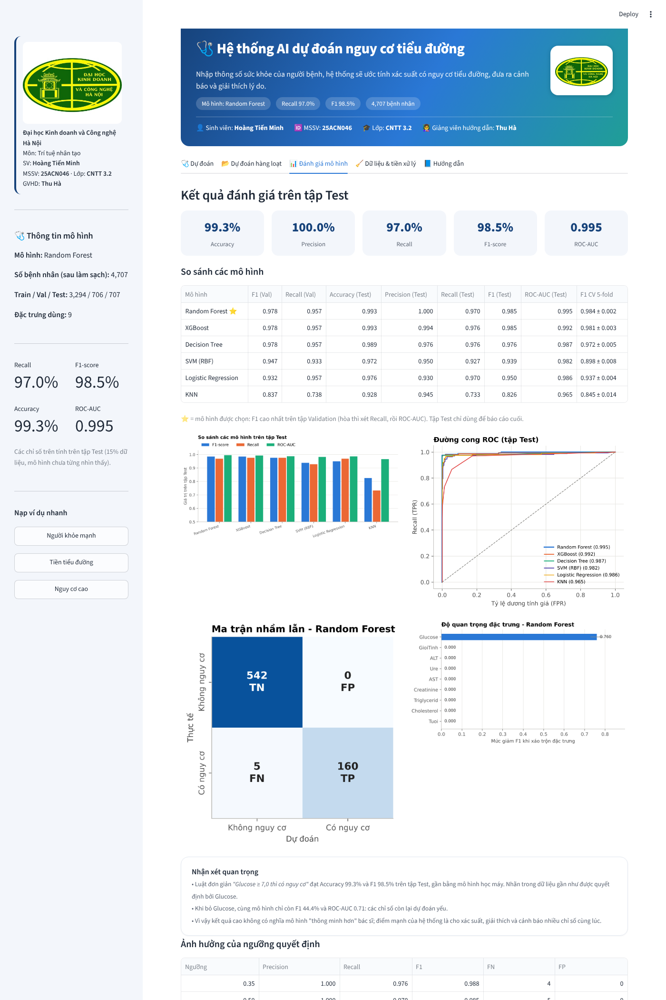
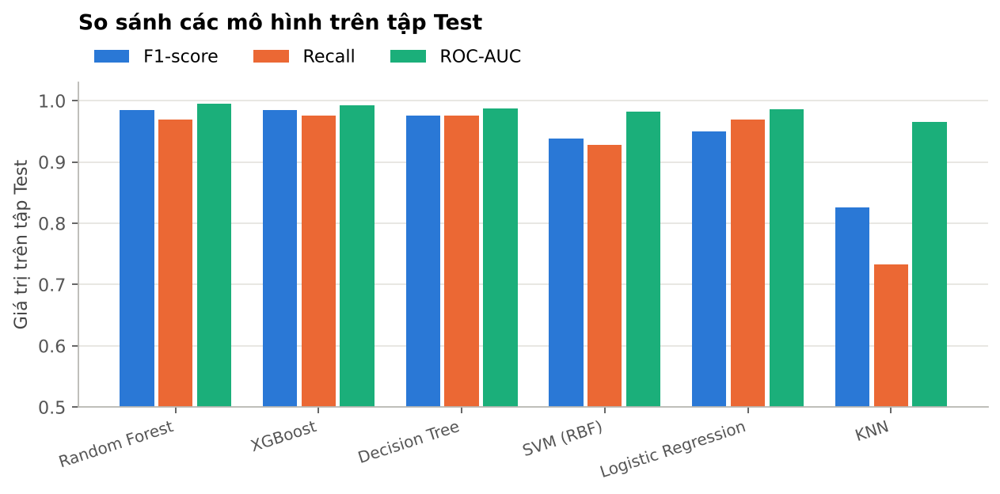
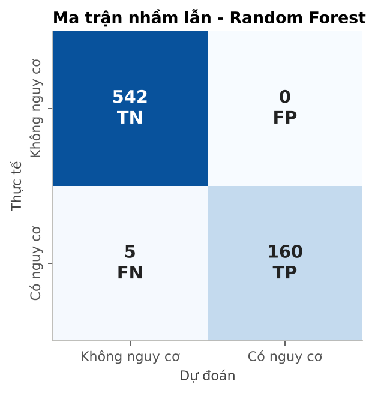

<p align="center">
  
</p>

<h1 align="center">Hệ thống AI dự đoán nguy cơ tiểu đường</h1>
<p align="center"><b>Bài kiểm tra môn Trí tuệ nhân tạo</b> · Trường Đại học Kinh doanh và Công nghệ Hà Nội</p>

| | |
|---|---|
| **Sinh viên** | Hoàng Tiến Minh |
| **MSSV** | 25ACN046 |
| **Lớp** | CNTT 3.2 |
| **Giảng viên** | Thu Hà |

Kính gửi cô Thu Hà, đây là bài kiểm tra em tự thực hiện bằng **Python** trên **Visual Studio Code**. Phần mềm dự đoán một người có **nguy cơ mắc bệnh tiểu đường** hay không từ tuổi, giới tính và các chỉ số xét nghiệm máu, sau đó đưa ra **cảnh báo** và **giải thích** kết quả. Báo cáo chi tiết có trong tệp [`HoangTienMinh_KiemTra_GiaiThich_HuongDan.docx`](HoangTienMinh_KiemTra_GiaiThich_HuongDan.docx).

## 1. Kết quả chính

| Mô hình được chọn | Accuracy | Precision | Recall | F1-score | ROC-AUC |
|---|---|---|---|---|---|
| **Random Forest** | 99,3% | 100% | 97,0% | 98,5% | 0,995 |

Các chỉ số tính trên **tập Test** (707 bệnh nhân, mô hình chưa từng nhìn thấy). Em ưu tiên **Recall** vì đây là bài toán sàng lọc bệnh, bỏ sót người có nguy cơ nguy hiểm hơn báo nhầm.

> **Lưu ý trung thực:** nhãn trong dữ liệu gần như do Glucose quyết định (luật "Glucose ≥ 7,0" cho kết quả ngang mô hình, còn bỏ Glucose thì F1 chỉ còn 0,44). Em đã nêu rõ điều này và các hạn chế trong báo cáo (mục 6.4 và mục 8).

## 2. Em đã làm đúng theo 7 bước của đề

| Bước | Em đã làm gì | Nằm ở đâu |
|---|---|---|
| 1. Xác định bài toán | Phân loại nhị phân: 1 = có nguy cơ, 0 = không | `train_model.py` (đầu tệp) |
| 2. Thu thập dữ liệu | 4.707 bệnh nhân, 14 cột (`data/CSDL_TieuDuong.csv`) | `train_model.py`, khối "BƯỚC 1-2" |
| 3.1. Làm sạch | Xử lý dữ liệu thiếu, đồng bộ (Male/Female, nhãn), giá trị lỗi, đổi đơn vị Glucose mg/dL, giới hạn ngoại lai, kiểm tra trùng; loại 4 cột bị điền sẵn (HbA1C, HDL, LDL, Acid Uric) | `ml_utils.py` (`clean_dataframe`, `Winsorizer`) |
| 3.2. Mã hóa + chuẩn hóa | One-Hot cho giới tính, StandardScaler cho cột số, tất cả trong Pipeline | `train_model.py` (`make_preprocessor`) |
| 3.3. Chia dữ liệu | 70% Train / 15% Validation / 15% Test, có phân tầng (stratify) | `train_model.py`, khối "BƯỚC 3.2-3.3" |
| 4. Chọn mô hình | Logistic Regression, Decision Tree, Random Forest, SVM, KNN, XGBoost | `train_model.py` (`MODELS`) |
| 5. Huấn luyện | Chỉnh siêu tham số trên Validation, kiểm định chéo 5 phần | `train_model.py`, khối "BƯỚC 4-5" |
| 6. Đánh giá | Accuracy, Precision, Recall, F1, ROC-AUC, ma trận nhầm lẫn, ngưỡng quyết định | `train_model.py`, khối "BƯỚC 6" |
| 7. Giao diện + cảnh báo + giải thích | Ứng dụng Streamlit 5 chức năng | `app.py` |

## 3. Cấu trúc thư mục

```
HoangTienMinh_KiemTra/
├── app.py                 # Bước 7: giao diện Streamlit (cảnh báo, giải thích)
├── train_model.py         # Bước 2-6: làm sạch, chia dữ liệu, huấn luyện, đánh giá
├── ml_utils.py            # Hàm dùng chung: làm sạch, giới hạn ngoại lai, cảnh báo xét nghiệm
├── requirements.txt       # Danh sách thư viện
├── Chay_ung_dung.bat      # Bấm đúp để chạy nhanh trên Windows
├── data/                  # Dữ liệu gốc và dữ liệu đã làm sạch
├── model/                 # Mô hình đã huấn luyện (.joblib) và số liệu (metrics.json)
├── figures/               # Biểu đồ phân tích và đánh giá
├── screenshots/           # Ảnh chụp giao diện
├── assets/                # Logo trường
├── .vscode/               # Cấu hình VS Code (bấm F5 để chạy)
└── HoangTienMinh_KiemTra_GiaiThich_HuongDan.docx   # Báo cáo giải thích và hướng dẫn
```

## 4. Hướng dẫn chạy

Máy cần có **Python 3.10 trở lên** (khi cài nhớ tích **Add Python to PATH**) và **Visual Studio Code**.

1. Tải mã nguồn về (nút **Code → Download ZIP** trên GitHub, hoặc `git clone`), giải nén.
2. Mở VS Code → **File → Open Folder** → chọn thư mục `HoangTienMinh_KiemTra`.
3. Mở Terminal (**Terminal → New Terminal**) và cài thư viện (chỉ một lần):

   ```bash
   pip install -r requirements.txt
   ```

4. *(Không bắt buộc, mô hình đã có sẵn trong `model/`)* Huấn luyện lại, mất khoảng 1 phút:

   ```bash
   python train_model.py
   ```

5. Chạy ứng dụng:

   ```bash
   python -m streamlit run app.py
   ```

   Trình duyệt tự mở trang <http://localhost:8501>. Nếu không tự mở, cô dán địa chỉ này vào trình duyệt. Muốn dừng ứng dụng: bấm **Ctrl + C** trong Terminal.

**Cách nhanh trên Windows:** bấm đúp `Chay_ung_dung.bat`. **Cách khác trong VS Code:** bấm **F5** rồi chọn "1. Huấn luyện mô hình" hoặc "2. Chạy ứng dụng Streamlit".

> Khi chạy lại trên máy khác, một vài con số nhỏ có thể lệch nhẹ ở chữ số thập phân do phiên bản thư viện khác nhau. Mô hình được chọn vẫn là Random Forest.

## 5. Hướng dẫn sử dụng ứng dụng

### Trang chủ
Thanh bên trái có logo, thông tin sinh viên, mô hình đang dùng, 4 chỉ số trên tập Test và các nút **ví dụ nhanh** (Người khỏe mạnh, Tiền tiểu đường, Nguy cơ cao).



### Chức năng 1: Dự đoán cho một người bệnh
1. Mở tab **Dự đoán**, nhập **Tuổi**, **Giới tính**, **Glucose** và các chỉ số xét nghiệm (hoặc bấm một ví dụ nhanh).
2. Bấm **Dự đoán nguy cơ**.
3. Đọc kết quả: xác suất và mức cảnh báo, phần "Vì sao có kết quả này?" (chỉ số nào tác động mạnh nhất), cảnh báo từng chỉ số theo ngưỡng y khoa và khuyến nghị.



| Xác suất | Mức cảnh báo | Ý nghĩa |
|---|---|---|
| ≥ 65% | **Có nguy cơ cao** | Nên đi khám, làm lại xét nghiệm đường huyết và HbA1C |
| 35% đến 65% | **Cần theo dõi thêm** | Mô hình chưa chắc chắn, nên xét nghiệm lại sau 1–3 tháng |
| ≤ 35% | **Nguy cơ thấp** | Duy trì lối sống lành mạnh, khám định kỳ |

### Chức năng 2: Dự đoán hàng loạt
Mở tab **Dự đoán hàng loạt**, tải file CSV mẫu, điền dữ liệu nhiều bệnh nhân rồi tải lên. Ứng dụng tự làm sạch dữ liệu, dự đoán và cho tải kết quả (đã xếp theo nguy cơ giảm dần) về dạng CSV.



### Chức năng 3: Xem đánh giá mô hình và dữ liệu
Tab **Đánh giá mô hình** hiển thị chỉ số trên tập Test, bảng so sánh 6 mô hình, ma trận nhầm lẫn, đường ROC, độ quan trọng đặc trưng. Tab **Dữ liệu & tiền xử lý** trình bày các bước làm sạch và biểu đồ phân tích.



## 6. Một số biểu đồ

| So sánh mô hình | Ma trận nhầm lẫn |
|---|---|
|  |  |

## 7. Lỗi thường gặp

| Hiện tượng | Cách xử lý |
|---|---|
| `ModuleNotFoundError: No module named ...` | Chạy lại `pip install -r requirements.txt` |
| `streamlit` is not recognized | Dùng `python -m streamlit run app.py` |
| Trình duyệt không tự mở | Dán <http://localhost:8501> vào trình duyệt, hoặc thêm `--server.port 8502` |
| Báo không nạp được mô hình | Chạy `python train_model.py` rồi mở lại ứng dụng |
| Không tìm thấy `CSDL_TieuDuong.csv` | Đặt file vào thư mục `data/` đúng tên |

## 8. Lưu ý

Ứng dụng chỉ mang tính **tham khảo và học tập**, **không thay thế chẩn đoán của bác sĩ**. Các ngưỡng cảnh báo là ngưỡng xét nghiệm phổ biến, mỗi phòng xét nghiệm có thể dùng giá trị tham chiếu hơi khác.

---
<p align="center">Bài kiểm tra môn Trí tuệ nhân tạo · Hoàng Tiến Minh · 25ACN046 · CNTT 3.2 · Giảng viên Thu Hà</p>
